<div align="center">


# twisty

**The curviest route.**

A motorcycle route planner for Spain. Put in where you start and where you are going, and it finds the twisty roads
in between. It takes the motorway when that gets you to them sooner, and a slider sets how much extra time goes on
curves. The ride goes to your navigation app, or out as a GPX file.

**Android, free. Not on Google Play yet:** for now you build it yourself ([Android app](#android-app)).

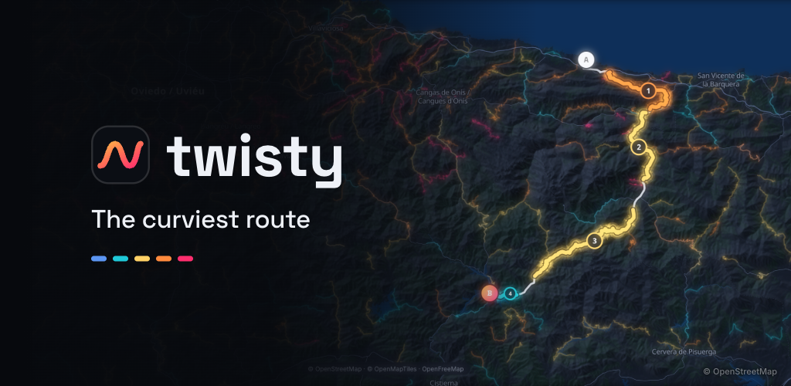

<sub>Map data © <a href="https://www.openstreetmap.org/copyright">OpenStreetMap</a> contributors (ODbL) · tiles <a href="https://openfreemap.org">OpenFreeMap</a> © <a href="https://openmaptiles.org">OpenMapTiles</a> · relief Terrain Tiles · <a href="#credits">full credits</a></sub>

</div>

---

## Why

Navigation apps treat "avoid motorways" as all or nothing. Either you stay on the motorway the whole way, or you
crawl out of the city and through every village on the way. A good ride is usually something else: the motorway to
the hills, then the twisty roads. Twisty plans that ride, and a slider lets you pick how many curves you want.

Routes come from OpenStreetMap and can be wrong. Road signs always win; never handle the phone while riding.

## Highlights

- **One slider, from the fastest route to the twistiest.** Up to 9 choices, each with the time it adds and the km of
  curves it gains over the fastest route.
- **Tight mountain roads count most,** fast sweepers less. Straights, motorways and town streets don't count, and
  slow country lanes count for little.
- **Over 5,500 twisty roads on the map,** in Spain, the Balearic and the Canary Islands, coloured from gentle to epic.
- **See the roads before you go.** The ride lists each twisty stretch with its road, length and character, and flags
  narrow stretches, fords and roads that close part of the year.
- **Stops and loops.** Up to 3 stops on a trip, or back to where you started by other roads.
- **Out to your navigation app.** Google Maps takes up to 9 waypoints, put on the best stretches first, so on a long
  ride it may skip a short one. Apps that follow a GPX line (OsmAnd, Kurviger, Calimoto, Garmin, Wikiloc…) get the
  exact ride. Waze is not offered: it takes only the destination.
- **Saved rides** in folders, and a ride can be shared as a text with its Google Maps link.
- **Dark, light and satellite maps,** with hillshade and 3D terrain. The satellite view shows the IGN's aerial photos close in and its Sentinel-2 mosaic zoomed out (the IGN is Spain's
  national mapping agency).
- **It plans without signal.** Routes and the search over 70,000 towns and villages work on the phone with no
  connection; the map itself needs data. There is no account.
- **English and Spanish,** following the device language.

## Screenshots

<table>
  <tr>
    <td width="50%">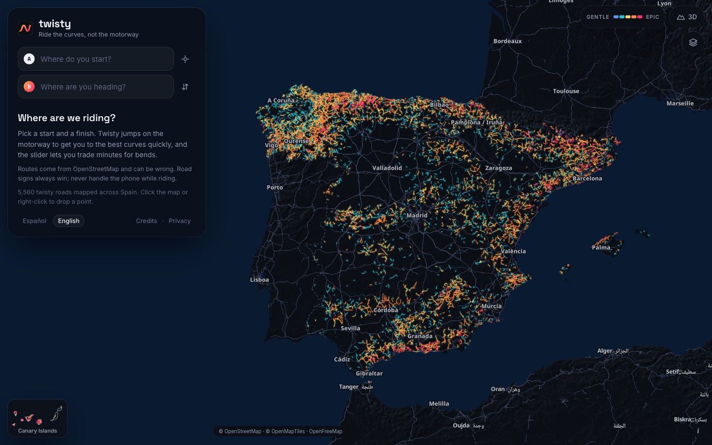</td>
    <td width="50%">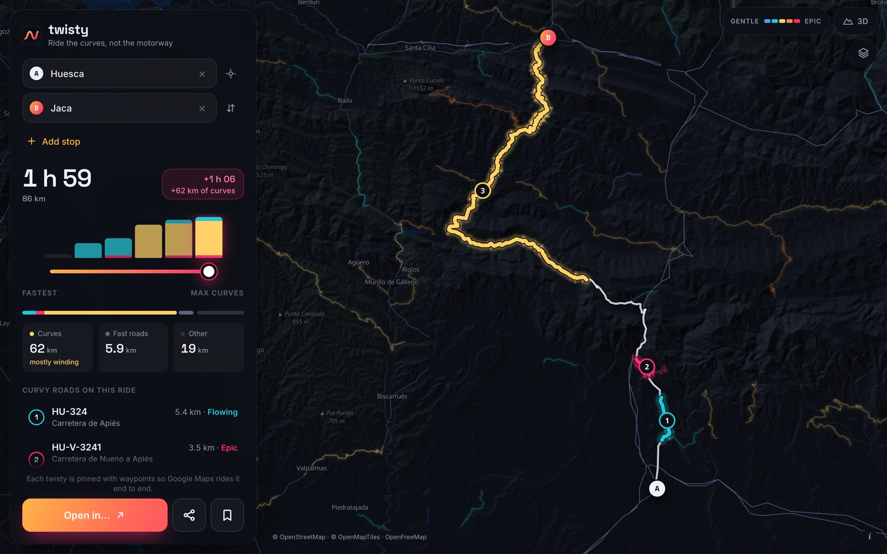</td>
  </tr>
  <tr>
    <td><b>The twisty roads of Spain</b>, coloured from gentle (blue) to epic (pink). The Canary Islands sit in their own box.</td>
    <td><b>Huesca → Jaca, max curves.</b> An hour more than the fastest route, and 62 km more of curves: the lanes by Apiés and Nueno, then the A-1205 up to Jaca.</td>
  </tr>
  <tr>
    <td>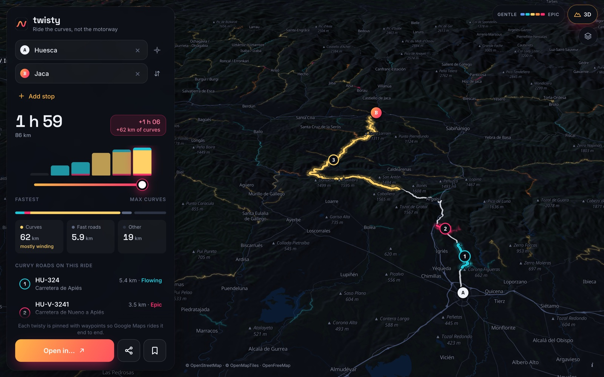</td>
    <td>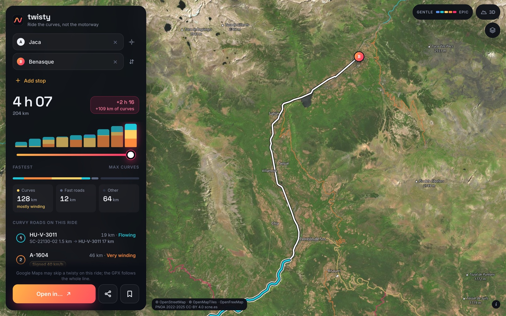</td>
  </tr>
  <tr>
    <td><b>3D terrain</b> on the same ride.</td>
    <td><b>Jaca → Benasque on satellite.</b> Close in, the map shows the IGN's aerial photos: here the last kilometres up the Ésera valley past Castejón de Sos.</td>
  </tr>
</table>

<sub>Map data © <a href="https://www.openstreetmap.org/copyright">OpenStreetMap</a> contributors (ODbL) · tiles <a href="https://openfreemap.org">OpenFreeMap</a> © <a href="https://openmaptiles.org">OpenMapTiles</a> · relief Terrain Tiles · satellite PNOA 2022-2025 CC-BY 4.0 <a href="https://www.scne.es/">scne.es</a> · <a href="#credits">full credits</a></sub>

### On a big screen

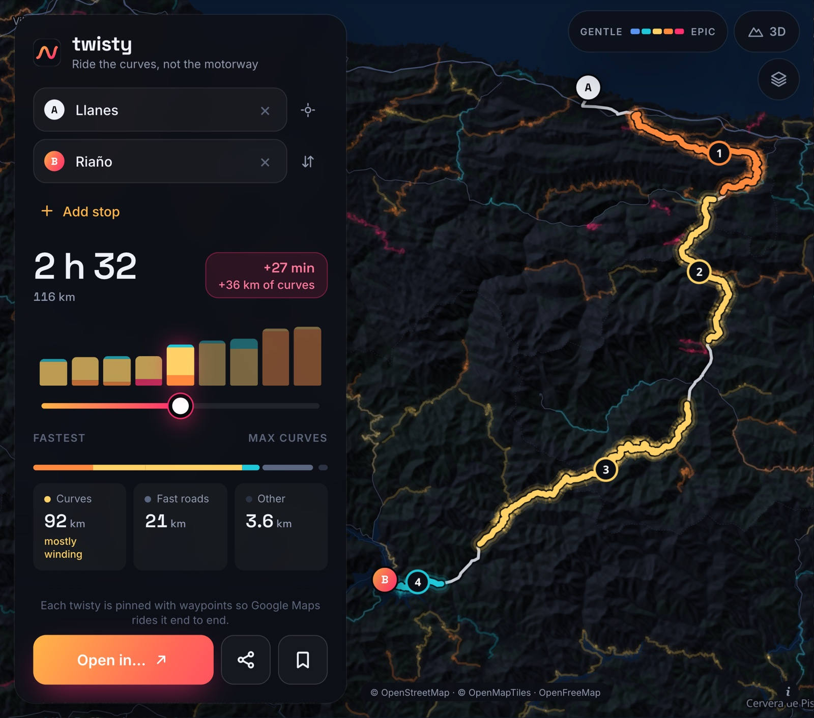

<b>Llanes → Riaño on a Galaxy Z Fold, opened.</b> 27 minutes more than the fastest route, and 36 km more of curves: the AS-343 to Panes, then the N-621 through the Hermida gorge to Potes and over San Glorio.

<sub>Map data © <a href="https://www.openstreetmap.org/copyright">OpenStreetMap</a> contributors (ODbL) · tiles <a href="https://openfreemap.org">OpenFreeMap</a> © <a href="https://openmaptiles.org">OpenMapTiles</a> · relief Terrain Tiles · <a href="#credits">full credits</a></sub>

### On the phone

The Google Play screenshots, from [`stores/android`](stores/android).

<table>
  <tr>
    <td width="25%">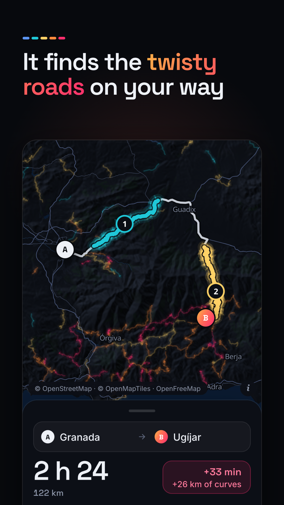</td>
    <td width="25%">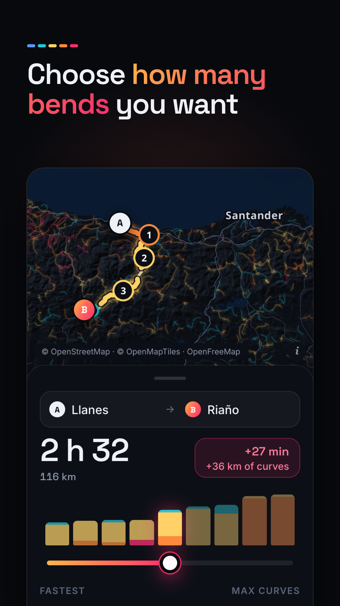</td>
    <td width="25%">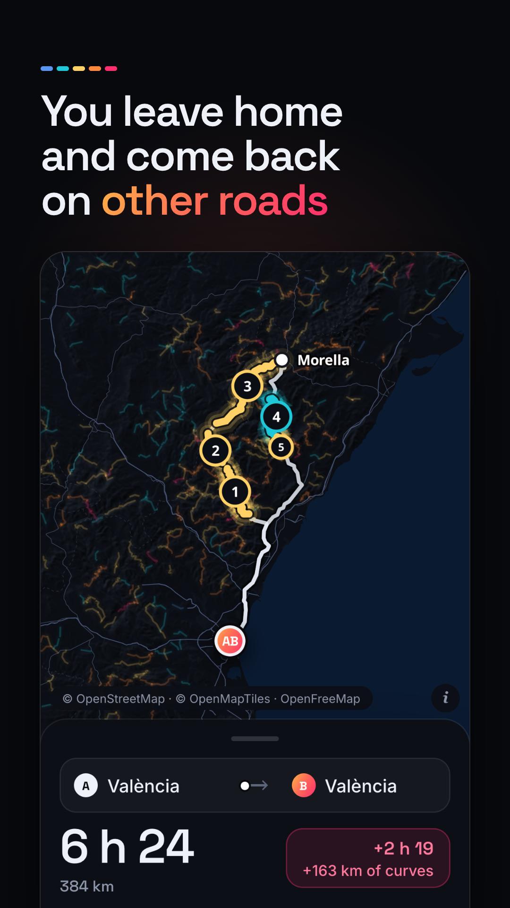</td>
    <td width="25%">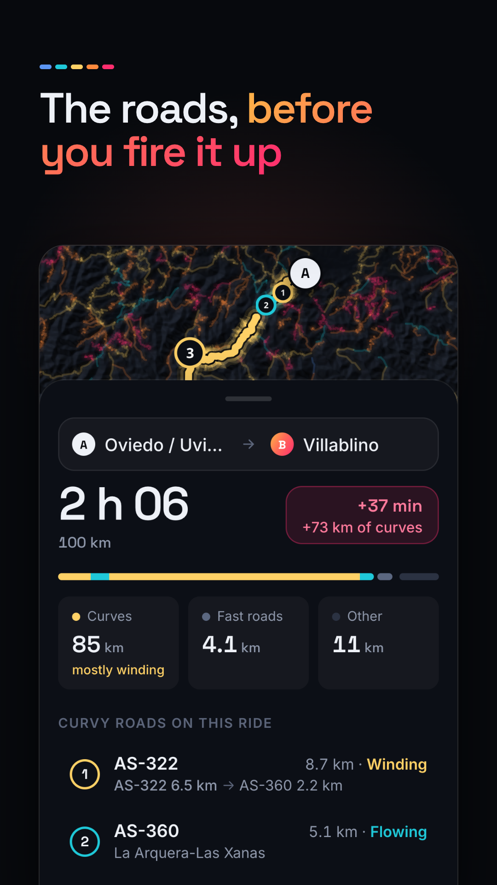</td>
  </tr>
  <tr>
    <td>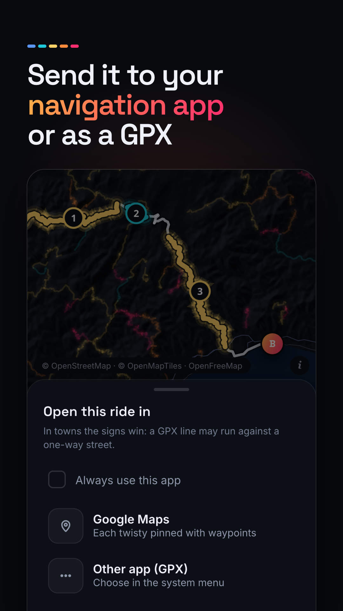</td>
    <td>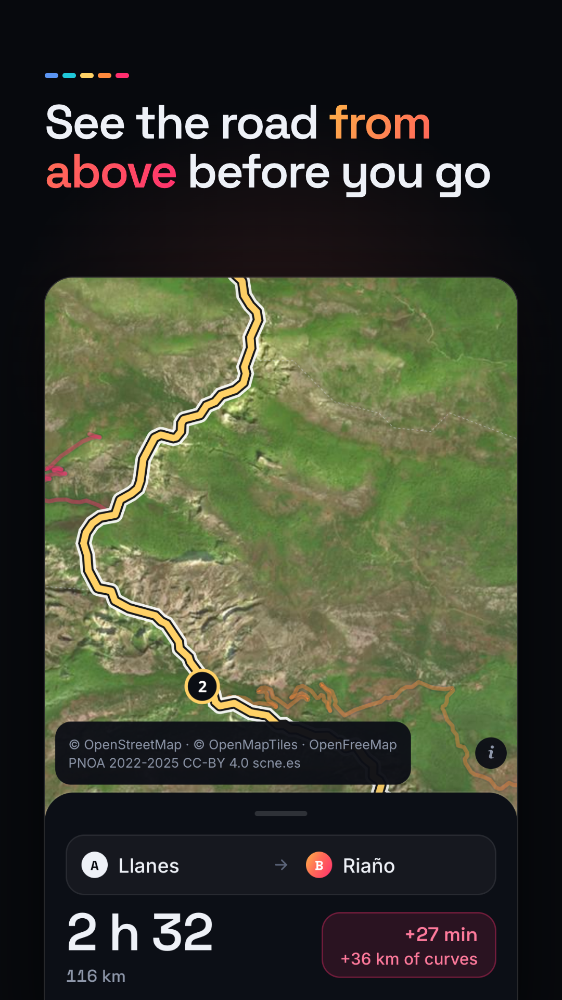</td>
    <td>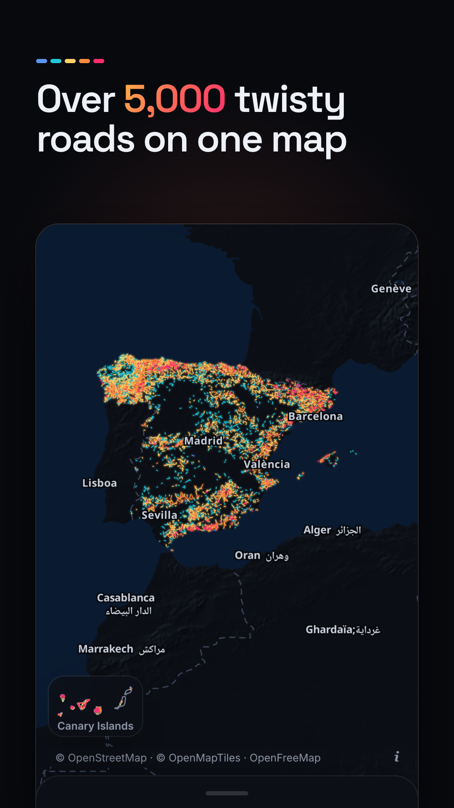</td>
    <td>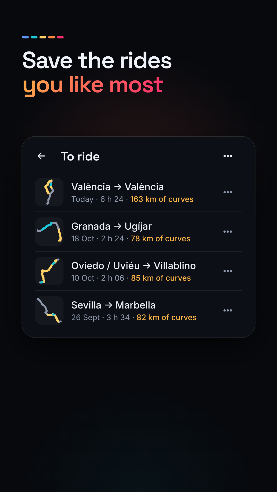</td>
  </tr>
</table>

<sub>Map data © <a href="https://www.openstreetmap.org/copyright">OpenStreetMap</a> contributors (ODbL) · tiles <a href="https://openfreemap.org">OpenFreeMap</a> © <a href="https://openmaptiles.org">OpenMapTiles</a> · relief Terrain Tiles · satellite PNOA 2022-2025 CC-BY 4.0 <a href="https://www.scne.es/">scne.es</a> · <a href="#credits">full credits</a></sub>

## How it works

See [`PRD.md`](PRD.md) for the product and [`ROADMAP.md`](ROADMAP.md) for what is next.

```
OpenStreetMap (Spain and the Canary Islands)
        │
        ▼
 ┌──────────────────────── pipeline/ (Python, about 20 min for Spain) ─────────────────────┐
 │ drivable roads → twistiness (°/km, 1 km window) → fun per metre, scaled by road class   │
 │ → contracted routing graph (time, fun, class, limits, fords, one-way, closures)         │
 │                                                              → graph.bin    50 MB      │
 │ → tracks layer, kept for the off-road update (not shipped)   → tracks.bin  146 MB      │
 │ → long curvy stretches rated 1–5                             → twisties.json (interim) │
 │ → towns, villages and hamlets with nearby context            → places.json             │
 └─────────────────────────────────────────────────────────────────────────────────────────┘
        │
        ▼
 ┌──────────────────────── app/scripts/ (Node, also part of make data) ────────────────────┐
 │ twisties.json → vector tiles z0–12 cut with geojson-vt          → overlay/              │
 │ graph.bin → the long curvy roads and the fastest legs between their ends               │
 │                                                                 → candidates.bin        │
 └─────────────────────────────────────────────────────────────────────────────────────────┘
        │
        ▼
 ┌──────────────────────── app/ (on the device, in a Web Worker) ──────────────────────────┐
 │ bidirectional Dijkstra per curve appetite k, edge cost = time · exp(−k · fun)           │
 │ + rides through each candidate road, and chains of them, within the detour              │
 │ → up to 9 slider stops → ride summary → Google Maps URL or GPX                          │
 └─────────────────────────────────────────────────────────────────────────────────────────┘
```

1. **Twistiness.** Geometry is de-noised (Douglas-Peucker, 5 m) and the heading change is summed over a sliding
   1 km window along the whole road, giving degrees per km anywhere on it.
2. **Fun share.** A piecewise-linear curve maps twistiness to 0–1: 40 °/km → 0, 150 °/km → 0.55, 500 °/km → 1.
   It counts in full on road classes that can be cruised at 60 km/h and fades to nothing at 40 km/h, so an
   unclassified lane keeps a quarter. Motorways, their links and town streets limited to 50 km/h or less get none.
   Outside towns posted limits are ignored on purpose: mountain roads are signed 30 or 40 to warn of the bends.
   One-way roads, roads closed part of the year, destination-only roads, rough surfaces and uncleared fords stay in
   the graph but lose their fun. Unpaved roads become tracks: a separate layer worth half the fun of tarmac, built
   but not offered in the app until the off-road update.
3. **Curve appetite.** With appetite `k`, a minute on a road with fun share `f` costs `exp(−k·f)` minutes; the time
   shown stays the real one. The planner searches at `k = 0` (the fastest route) and at a fixed set from 1 to 8.
   Higher appetites bend the route towards good roads, while motorways keep their real cost, so they are still used
   to get there quickly.
4. **Candidate roads.** Once per data build, the long curvy roads of the whole graph are found, with the fastest legs
   between their ends (`candidates.bin`). For a trip, every candidate within a 90-minute detour is tried: the fastest
   way to its entry, the road, the fastest way from its exit to the finish. One search forward from the start and one
   backward from the finish reach them all. Chains of two or more roads are built the same way, keeping the chain with
   the most fun for each 5-minute time budget.
5. **Slider stops.** The options are cut to at most 9 stops chosen together: the set that gives the most fun across
   the slider, with a place for great roads (rated 4 or more, at least 8 km). Each stop has more time, more fun and
   more twisty km than the one before it.
6. **Stops and loops.** A trip can have up to 3 stops, or end where it started. Each leg is planned on its own and the
   legs are combined; a road ridden in two legs counts once, and out-and-back on the same road is not offered.
7. **Google Maps and GPX.** The best twisties get entry and exit waypoints 250 m inside the road and interior pins on
   long ones, 9 waypoints at most, with the rider's own stops first. Pins keep clear of stretches ridden against a
   one-way street. Apps that read GPX get the whole line.

## Tech stack

| Layer | Choice |
|---|---|
| Data pipeline | Python 3, pyosmium, numpy, osmium-tool, pytest |
| App | Svelte 5 (runes), TypeScript (strict), Vite, Vitest |
| Map | MapLibre GL JS, OpenFreeMap vector tiles with a custom style, AWS Terrarium DEM, IGN aerial photos |
| Overlay | Vector tiles cut in Node with geojson-vt, the tiler MapLibre uses itself |
| Routing | Bidirectional Dijkstra over typed arrays (CSR adjacency) in a Web Worker |
| Search | Offline place index; Nominatim for streets on request |
| Mobile | Capacitor 8 (Android), data bundled in the app |

## Project structure

```
twisty/
├── pipeline/          Python: OSM extracts → graph.bin, tracks.bin, places.json, twisties.json (interim)
│   ├── twisty_pipeline/
│   └── tests/
├── app/               Svelte + MapLibre client
│   ├── android/          Capacitor Android project
│   ├── bench/            Route-quality bench (docs/route-quality-bench.md)
│   ├── scripts/          Overlay tiles and candidate roads (Node)
│   ├── src/components/   Map, panel, slider, place search, ride summary
│   ├── src/lib/routing/  Graph search, planner, slider stops, ride building
│   ├── src/lib/map/      Map style, layers, route animation
│   └── public/data/      Pipeline output (git-ignored)
├── stores/
│   ├── android/          Google Play listing in fastlane supply's layout (texts and images, EN and ES)
│   └── src/              Scripts that capture the app and render the store images
├── docs/
│   ├── privacy/          Privacy policy (GitHub Pages)
│   └── screenshots/
├── Makefile           setup, data, dev, test, apk, bundle, data-release… (`make` lists them all)
├── LICENSE.md         PolyForm Noncommercial 1.0.0
├── PRD.md             Product requirements
├── ROADMAP.md         Phases and progress
└── CLAUDE.md          Engineering rules for contributors and agents
```

## Getting started

Requirements: Python 3.12+, Node 22.18+, `osmium-tool` (`brew install osmium-tool`). Run `make` to list every target.
`make setup` looks for a Python 3.12+ on its own (`python3.13`, `python3.12`, `python3.14`, then `python3`) and stops with
a clear message if there is none; pass `PYTHON=/path/to/python` to choose one.

```bash
make setup   # Python venv for the pipeline + npm dependencies for the app
make data    # download Spain (1.5 GB) and the Canary Islands (60 MB), build app/public/data (about 20 minutes)
make dev     # dev server on http://localhost:5173, also reachable from phones on the same Wi-Fi
make test    # pipeline tests, app tests and type checks
```

The generated data (`app/public/data`) is git-ignored: about 65 MB that the app ships, plus the 146 MB tracks layer
that it does not. Instead of `make data` you can copy that folder from another machine.

## Android app

The app is wrapped with [Capacitor](https://capacitorjs.com). The web build **and the data** ship inside the app,
so routing and town search work without any server; only map tiles, street search and the navigation app need a
connection.

Extra requirements: JDK 21, the Android SDK (`ANDROID_HOME` set) and `adb` for installing.

```bash
make apk               # build → sync into app/android → gradle assembleDebug → dist/twisty-debug.apk (about 40 MB)
make install           # build and install on the phone connected over USB (USB debugging on)
make run               # build, install and launch
make logs              # follow the WebView console and Capacitor logs from the phone
make bundle            # signed release bundle for Google Play → dist/twisty-release.aab (needs the upload key)
make publish-internal  # upload that bundle to the Play internal testing track (fastlane)
```

The upload key and the Play service account are named in the git-ignored `app/android/local.properties`.
The store listing lives in `stores/android`, in fastlane supply's layout. Until the app has a release, `fastlane supply`
cannot upload it (it looks for the track's release first), so `stores/src/play-listing.rb` does it with fastlane's Play
client: `validate` first, then `commit`, with the Play service account's key file (see the script's header).

Without a cable, copy `dist/twisty-debug.apk` to the phone and open it (allow installing from unknown sources).

## Testing

```bash
make test
# or individually
cd pipeline && .venv/bin/pytest   # geometry, curvature and fun, road tags, built-up areas, chains, graph, export, places
cd app && npm test                # routing and planner, slider stops, ride building, bench logic, UI flows, Google Maps and GPX
cd app && npm run check           # svelte-check + TypeScript for the app, tests, bench and scripts
make bench                        # plan the bench trips and report route quality (docs/route-quality-bench.md)
```

The app test suite includes a smoke test on the real Spain data (skipped when it has not been built) that plans
Madrid → Granada, València → Los Santos and Huesca → Jaca and prints every slider stop.

## Privacy

Twisty runs no servers and has no account. It sends no analytics or crash reports and shows no ads. Routing and town
search run on the device, and saved trips stay there (and in your own Android backup, if it is on). Data leaves the
phone in these cases:

- Map tiles and label fonts come from OpenFreeMap (through Cloudflare), Terrain Tiles on AWS and, in the satellite
  view, the IGN (through Amazon CloudFront). These services see your IP, the app's browser identification and the area
  in view.
- A street search, only when you tap it, sends Nominatim (run by the OpenStreetMap Foundation, which logs requests)
  the typed text and a search area around a point rounded to about 10 km, and may add the name of the town within
  about 4 km of that point. It never sends your exact position.
- Opening a ride in Google Maps sends a link with the start, the finish and up to 9 waypoints.
- Open in… and Share hand a GPX file, or a summary with that link, to the app you pick.

The GPX starts or ends at your position when the trip does. When a trip ends at My location (a loop with Back to the
start, or a trip turned round), the Google Maps link, and so a shared ride, contains that position, exact to a few
metres. A saved ride keeps that position, and planning it again sends it like any other place. The full policy, in English and Spanish,
is [`docs/privacy`](docs/privacy/index.html), published at https://sanchezpaco.github.io/twisty/privacy.

## License

The code is under the [PolyForm Noncommercial License 1.0.0](LICENSE.md): anyone may read, run, change and share it
for any noncommercial purpose; commercial use needs the author's permission. The road data is not covered by it: it is
a Derivative Database of OpenStreetMap under the ODbL. Neither is the third-party map imagery in the screenshots and
store images (OpenStreetMap, OpenMapTiles, Terrain Tiles, PNOA), which stays under its own licences (see Credits).

## Credits

Map data © [OpenStreetMap](https://www.openstreetmap.org/copyright) contributors (ODbL).
The road data the app ships (`graph.bin`, `candidates.bin`, `places.json`, `overlay/`) is a Derivative Database of
OpenStreetMap under the [ODbL 1.0](https://opendatacommons.org/licenses/odbl/1-0/); the pipeline writes the notice to
`app/public/data/LICENSE.txt`.
`make data-release` packs those files, with `meta.json` and the notice, into `dist/twisty-data-v<version>-<built>.zip`, the
free copy the notice points to (upload it as an asset of a release of the public repository).
Base map tiles by [OpenFreeMap](https://openfreemap.org) / [OpenMapTiles](https://openmaptiles.org).
Elevation: [Terrain Tiles](https://registry.opendata.aws/terrain-tiles/) (Mapzen, AWS Open Data, accessed 2026-10-16).
Europe terrain data produced using Copernicus data and information funded by the European Union - EU-DEM layers.
SRTM and GMTED2010 terrain data courtesy of the U.S. Geological Survey.
ETOPO1: NOAA National Centers for Environmental Information.
Satellite view: aerial orthophotos [PNOA](https://pnoa.ign.es/) 2022-2025 CC-BY 4.0 [scne.es](https://www.scne.es/) (Plan
Nacional de Ortofotografía Aérea; Instituto Geográfico Nacional, regional governments and CNIG, Sistema Cartográfico
Nacional). At small scales: MosaicoSentinel2 2018-2026 CC-BY 4.0 [ign.es](https://www.ign.es/), containing modified
[Copernicus Sentinel data](https://sentinels.copernicus.eu/documents/247904/690755/Sentinel_Data_Legal_Notice). Melilla:
Pléiades Neo © Airbus DS (2022). World background: NASA MODIS. In the app the imagery is shown unmodified from the IGN tile service.
Address search by [Nominatim](https://nominatim.org), only on request. It sends the typed text and a search area around a
point rounded to 0.1 degree (about 10 km): the place already in the field or, if location is already allowed, the rider's
position. It may also send the name of the town within about 4 km of that point, which can say more than the rounded
point. It never sends the exact position.
